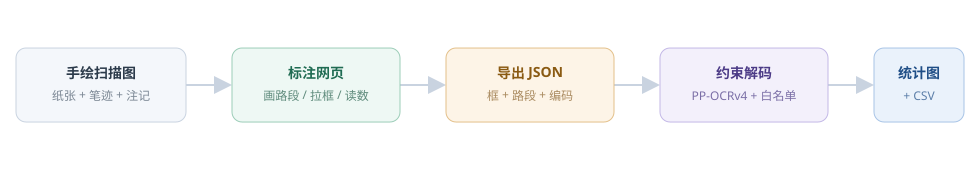

# Park Behavior Mapping

把**手绘的公园人群行为注记图**变成结构化数据与出版级图表。

> **方法与出处**
> 本项目的标注方法——`人数-性别-活动` 三编码体系、以"两个交点之间为一段路"划分路段、按段汇总人数与停留特征——由 **Hon Sytsi** 提出，用于**风景园林**专业的建成环境行为观察（使用后评价 / post-occupancy evaluation）。
> 本仓库是该方法的数字化实现：标注在浏览器里完成，统计与出图自动生成。
> 完整编码规则见下文 **[方法：Hon Sytsi 编码](#方法hon-sytsi-编码)**（观察单元、三字段判定、路段划分、汇总口径）。
> 若在论文或设计研究中使用该方法，请引用 Hon Sytsi 的原始工作（见 [CITATION.cff](CITATION.cff)）。

> 扫描一张手绘平面图 → 在网页里圈注记、画路段 → 半自动读出 `人数-性别-活动` 编码 → 按路段汇总 → 输出统计图与 CSV。

这是风景园林专业的现场调研工具：一张平面图、一支笔记录一天的人流，回来却要花几天转录成表格。这个仓库把那几天压缩到一两个小时——**方法不变，只是把誊抄和汇总交给机器**。



## 它解决什么

现场注记通常长这样：一张手绘平面图，路口写着 `10-2-6`，含义是「10 人、女性为主、在用手机」。

问题是：

- **它不可计算**。想统计"哪段路停留最久"，只能靠眼睛数。
- **OCR 读不出来**。字高约 12×20 px，被箭头和引线压着。实测：TrOCR 把 `2-3-1` 读成 `girls . I`，EasyOCR 切成 `4 | 4 | 72 | 3`，PP-OCRv4 把 `2-1-5` 读成 `J-2J`。
- **框和路段对不上**。一个注记框切成了两半，两个注记并成了一个框。

这个工具的三条对策：**给框加旋转矩形约束**、**用白名单约束 CTC 解码**、**用人工确认兜底**。

## 组成

| 部分 | 作用 |
|---|---|
| `python/build_tool.py` | 把扫描图打包成**单文件网页**（图片 base64 内嵌，离线可用） |
| 标注网页 | 画路段（沿笔迹自动寻路）、拉框、自动吸附、读数、导出 JSON |
| `python/ocr_read.py` | PP-OCRv4 + **白名单约束解码**，对每个框给出建议值 |
| `python/render_figure.py` | 生成线稿版统计图 + 分段 CSV |
| `skill/SKILL.md` | Agent Skill：把整套流程（含踩坑清单）交给 AI 执行 |

## 快速开始

```bash
pip install -r python/requirements.txt
# OCR 引擎单独装，避免污染主环境
pip install --target ./ocr rapidocr-onnxruntime

# 0) 没有素材？先合成一张演示图
python demo/make_demo.py

# 1) 生成标注网页
python python/build_tool.py --images demo/park1.jpg --labels 演示公园 --out demo/tool.html

# 2) 浏览器打开 demo/tool.html，画完导出 标注结果.json

# 3) 读数字（给出建议值）
PBM_OCR_PATH=./ocr python python/ocr_read.py --export 标注结果.json --images i1=demo/park1.jpg

# 4) 出图
python python/render_figure.py --export 标注结果.json --key i1 \
  --image demo/park1.jpg --out 图1.png --csv 统计.csv
```

## 方法：Hon Sytsi 编码

这套方法把现场观察压缩成一个短串——`10-2-6`。三段数字分别回答三个问题：**多少人 / 什么性别构成 / 在做什么**。

一句话概括：**在平面图的行为发生位置，用三段码记录"同一地点、同一活动的一群人"，再以道路交点为界分段汇总。**

### 1. 观察单元

一条注记 = 一次观察 = **同一地点、同一活动的一群人**。

| 情形 | 记法 |
|---|---|
| 三人结伴散步 | 记一条 `3-x-1`，不拆成三条 |
| 两人挨着，一个坐着一个跑步 | 记两条（活动不同） |
| 同一群人换了位置，或换了活动 | 另起一条 |
| 一个人来回走两趟 | 仍记 1 人（是人数，不是人次） |

### 2. 三个字段

**① 人数（1–2 位）**

现场同时在场的人数。超过 20 人可估整（25、30…），用两位数。

**② 性别（1 位）**

| 码 | 含义 | 判定 |
|---|---|---|
| 1 | 男性为主 | 组内男性明显多于女性 |
| 2 | 女性为主 | 组内女性明显多于男性 |
| 3 | 男女均衡 | 数量相当，或无法判定主导 |

单人观察时取该人性别。远距离、背身等无法判定的情况记 3，并在备注说明。

**③ 活动（1–13）**

| 码 | 活动 | 判据 |
|---|---|---|
| A1 | 步行 / 散步 | 沿路移动，不停留 |
| A2 | 跑步 | 明显快于步行 |
| A3 | 骑行 / 轮滑 | 有自行车、滑板车、轮滑鞋 |
| A4 | 坐憩 / 休息 | 坐在座椅、台阶、草地 |
| A5 | 社交交谈 | 站立交谈、围坐聊天 |
| A6 | 亲子活动 | 成人带儿童，以儿童活动为主 |
| A7 | 锻炼 / 健身 | 器械、拉伸、太极等 |
| A8 | 遛狗 | 有牵引或伴行犬只 |
| A9 | 野餐 / 饮食 | 铺毯进食、就餐 |
| A10 | 使用手机 / 阅读 | 注意力在手机、书报、屏幕 |
| A11 | 拍照 / 观景 | 举机拍摄、驻足看景 |
| A12 | 文化活动 | 观展、演出、讲解 |
| A13 | 其他 | 以上都不是 |

一条注记只记**主导活动**。边走路边看手机：以移动为主记 1，长时间站着看记 10。

### 3. 注记写在哪里

写在**行为发生的位置**——不是人来的方向，也不是视线落点。

### 4. 路段怎么分

以道路的**交点**为界：交叉口、丁字口、明显的转折点。两个交点之间为一段。

- 一段可以有多条注记，这正是分段统计的意义所在；
- 一条注记只归属一段；画在交界处时，归入人流主要所在的那一段；
- 环状路径在交点处断开，不首尾连成一段。

### 5. 汇总口径

| 指标 | 定义 |
|---|---|
| 段人数 | 该段所有注记人数之和 |
| 段性别构成 | 按码 1/2/3 分别累加人数 |
| 段主导性别 | 人数最多的一类；三类并列记 0（持平） |
| 段主导活动 | 人数最多的活动码 |
| 停留等级 | 由活动推导：1–3 路过 / 8、11 短暂停留 <5min / 其余持续 ≥5min |
| 段主导停留 | 停留人数最多的等级 |

### 6. 一个完整例子

路口东侧长椅上坐着 10 个人，以女性为主，多数在看手机 → `10-2-6`
拆开读：10 人 · 女性为主 · 使用手机 → 停留等级 3（持续 ≥5min）。

同一段路上另有 3 个男性在跑步 → `3-1-2`。
该段汇总：合计 13 人（男 3 / 女 10），主导活动为使用手机，主导停留为 3。

### 7. 现场操作要点

- 先在图上标出路段交点，再开始计数，避免边走边忘；
- 两人一组最快：一人读、一人记；单人时按"人数 → 活动 → 性别"的顺序，性别最后扫一眼；
- 短横可省，`1026` 与 `10-2-6` 等价（本工具两种都能读入，`1026` 会按编码规则自动拆）。

### 8. 本仓库补充的实现约定

以下**不属于方法本身**，是为自动化出图做的具体化；若与 Hon Sytsi 的原始口径冲突，以原文为准：

- 停留映射表（第 5 条）为便于统计而固定；
- 性别码 3 在汇总时单列"均衡"，不折算进男 / 女；
- 路段用折线近似（手绘图上的弧线以多点折线拟合），仅用于归属判定，不参与面积或长度计算。


## 为什么需要人工确认

约束解码把识别率从不可用提到约 45%。剩下的靠人，但人只需要**确认**而不是**输入**。

这是有意为之的取舍：这类手写体在任何现成模型上都读不到 90%，与其给出 55 个错误值让人逐个改，不如给出 45 个对的 + 一堆空白。

## 目录

```
python/     三个命令行工具（打包 / 识别 / 出图）
skill/      Agent Skill（交给 AI 执行）
demo/       合成演示数据（无需真实素材即可试跑）
docs/       流程图与工作流详解
```

## 引用

```bibtex
@software{park_behavior_mapping,
  title  = {Park Behavior Mapping: 手绘行为注记图的分段统计工具},
  author = {Sytsi, Hon and Cat0ntheRoof},
  year   = {2026},
  note   = {标注方法由 Hon Sytsi 提出；本仓库为其数字化实现},
  url    = {https://github.com/Cat0ntheRoof/park-behavior-mapping}
}
```

## 关于数据

本仓库**不包含任何真实调研数据**：`demo/park1.jpg` 与 `demo/truth.json` 由 `demo/make_demo.py` 程序合成，仅用于跑通流程。
实际使用的扫描图与标注结果请自行保管，不要提交到公开仓库。

## 许可

代码 MIT。**标注方法的知识产权归 Hon Sytsi**，本仓库仅提供实现；方法本身的使用请遵循其原始发表的要求。

OCR 使用 [RapidOCR](https://github.com/RapidAI/RapidOCR) 打包的 PP-OCRv4 ONNX 模型（Apache-2.0）。
